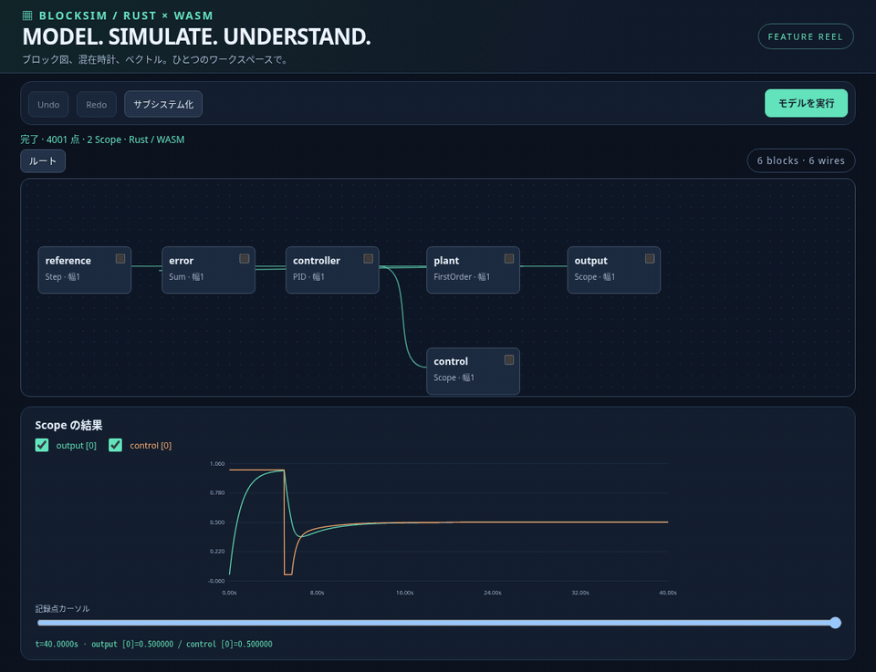
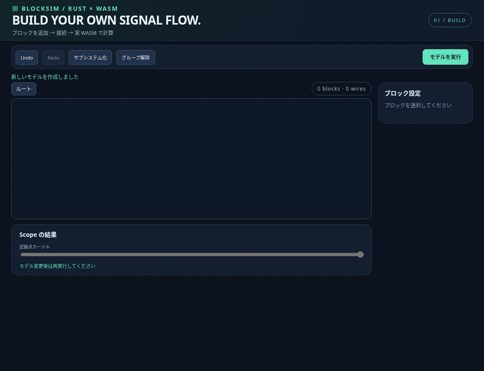
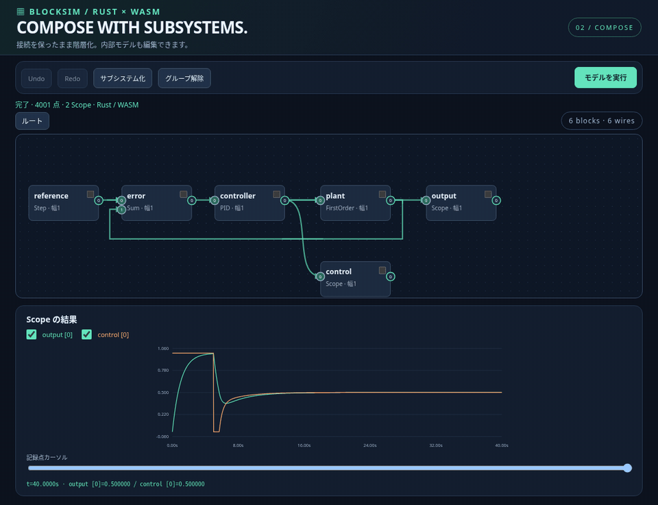
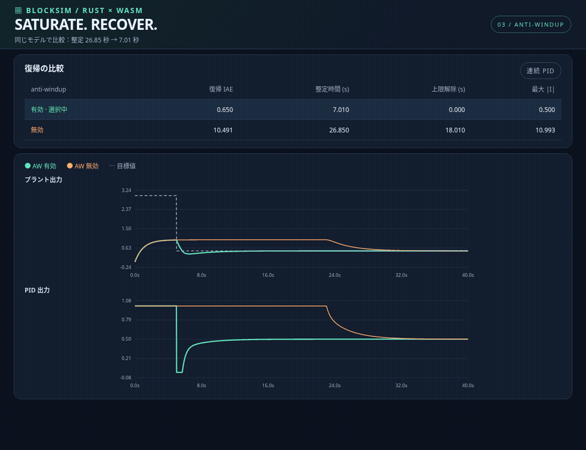
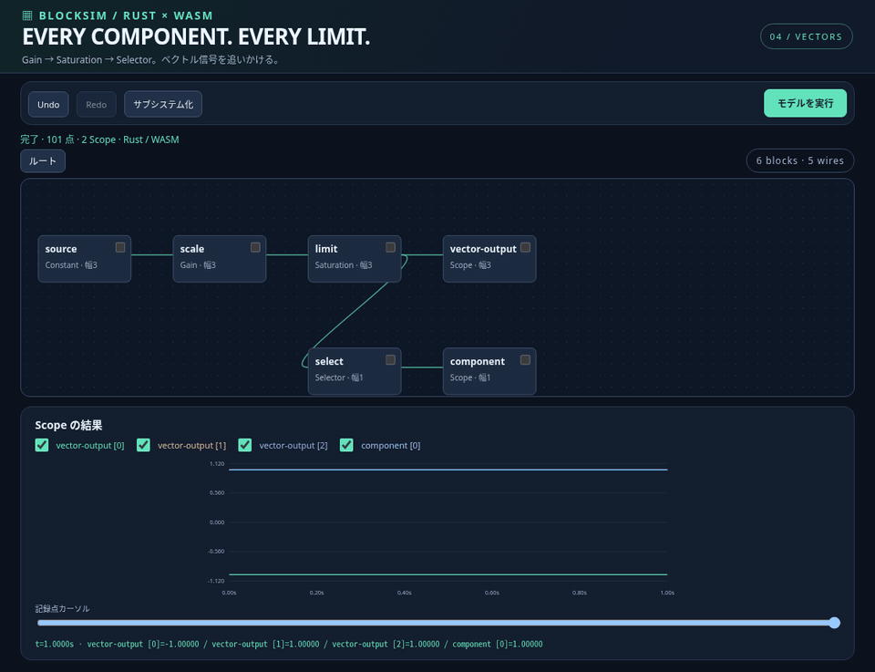
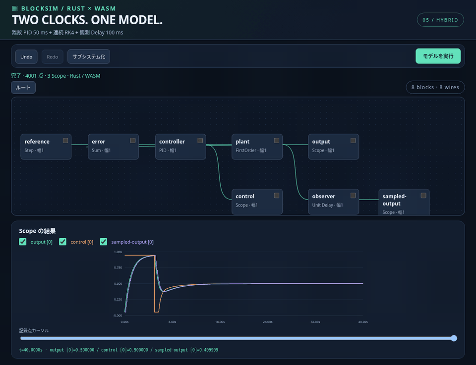
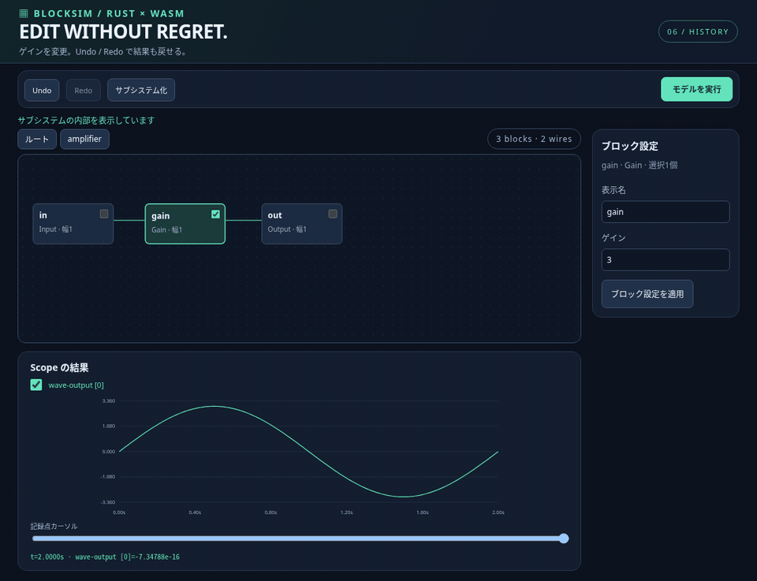

# BlockSim

Rust + WebAssembly によるブロック図モデリング・PID 制御実験環境です。連続／離散 PID の出力制限、条件付き積分による anti-windup、ベクトル対応 Saturation ブロックを実装しています。ブラウザ GUI でモデルを設定し、目標値を下げた後の復帰を有効／無効で比較できます。

<p align="center">
  <strong>MODEL · SIMULATE · UNDERSTAND</strong><br>
  <sub>Rust × WebAssembly — ブロックをつなぎ、信号の動きを確かめる。</sub>
</p>

<p align="center">
  <a href="docs/media/hero.gif"></a>
</p>

<p align="center">
  <strong>ブロック図</strong> · <strong>連続／離散</strong> · <strong>ベクトル</strong> · <strong>サブシステム</strong> · <strong>anti-windup</strong>
</p>


**成熟度比較コメント：目標は Simulink 比30%を維持。現在の概算は Simulink 比約30%、Scilab/Xcos 比約35%です。これは主観的な開発評価であり、機能網羅率や客観的なベンチマークではありません。** 基本ブロック図・サブシステム・ベクトル・同期した連続／離散混在を実装しました。可変刻みソルバ、物理領域、コード生成、Simulink ファイル互換は未実装です。評価の根拠は [成熟度評価](docs/maturity.md) に記載しています。


## 動く BlockSim

GIF をクリックすると大きく表示できます。すべて実際の GUI 操作と WASM 計算から録画しています。録画では見やすいレイアウト・見出し・波形の描画演出を加えています。波形の描画演出は録画用で、リアルタイムのシミュレーション再生機能ではありません。

<table>
  <tr>
    <td width="50%" align="center">
      <strong>01 — Build your own signal flow</strong><br>
      <a href="docs/media/build.gif"></a><br>
      <sub>追加 → ポートをクリックして接続 → 実行。</sub>
    </td>
    <td width="50%" align="center">
      <strong>02 — Compose with subsystems</strong><br>
      <a href="docs/media/subsystems.gif"></a><br>
      <sub>接続を保ったまま階層化・グループ解除。</sub>
    </td>
  </tr>
  <tr>
    <td width="50%" align="center">
      <strong>03 — Saturate. Recover.</strong><br>
      <a href="docs/media/anti-windup.gif"></a><br>
      <sub>同じモデルで復帰比較。整定 26.85 s → 7.01 s。</sub>
    </td>
    <td width="50%" align="center">
      <strong>04 — Every component. Every limit.</strong><br>
      <a href="docs/media/vectors.gif"></a><br>
      <sub>各成分を独立に制限。必要な系列を選んで確認。</sub>
    </td>
  </tr>
  <tr>
    <td width="50%" align="center">
      <strong>05 — Two clocks. One model.</strong><br>
      <a href="docs/media/hybrid.gif"></a><br>
      <sub>50 ms PID × 連続 RK4 × 100 ms 観測。</sub>
    </td>
    <td width="50%" align="center">
      <strong>06 — Edit without regret</strong><br>
      <a href="docs/media/history.gif"></a><br>
      <sub>ゲイン変更、Undo／Redo、保存。試行錯誤を軽く。</sub>
    </td>
  </tr>
</table>

[GIF の生成方法とサイズ](docs/media/README.md) · [ブロック図の仕様](docs/graph.md) · [数値検証](docs/validation.md)

## さらに使いやすく

- **ポートから配線**：出力→入力をクリック。Escape で中止し、接続済み入力や幅不一致はその場で拒否します。右の接続フォームも使えます。
- **線を選んで削除**：矢印付きの線をクリック／Enter で選択し、削除ボタンまたは Delete で削除。フィードバック線はブロックの下を通して表示します。
- **グループ解除**：サブシステムの境界をつなぎ直して展開。設定・ベクトル幅・分岐・フィードバックを保持し、Undo／Redo に対応します。
- **モデルを追加読み込み**：読み込み方法を「既存モデルに追加」にすると、元のモデルを残して取り込めます。ID の衝突を回避し、既存の時計・終了時刻を保持します。

## 開発環境

必要なもの：Linux、Bash、C コンパイラ、curl、Node.js 24（`.node-version`）、npm、Rust 1.90.0、`wasm32-unknown-unknown`、wasm-bindgen CLI 0.2.100。ブラウザテストには Chromium が必要です。追加サービス・認証情報は不要です。

```bash
cd /workspace/BlockSim
./scripts/setup.sh
source scripts/rust-env.sh
./scripts/check.sh
./scripts/start.sh
```

`setup.sh` は Rust がなければ導入し、固定バージョンのツールと lockfile から依存関係を準備して、WASM と GUI をビルドします。管理する Rust と npm キャッシュはチェックアウトの外側（クラウドでは `/workspace/.blocksim-tools`）に置きます。既存のシステム Rust があれば利用します。`BLOCKSIM_TOOL_ROOT` で場所を変更できます。Rust のコマンドを単独で実行するときは `rust-env.sh` を source してください。

`web/src/wasm/` は生成物です。Rust を変更したら `./scripts/build-wasm.sh` を再実行してください。`npm run build` は生成済み WASM を使います。`web/dist/` に静的配信用ファイルを出力します。起動後は `node web/scripts/smoke.mjs` で WASM 計算と表示を確認できます。

ブラウザテストは `/usr/bin/chromium` を利用します。別のパスは `CHROMIUM_PATH` で指定できます。システム Chromium がない場合は `cd web && npx playwright install --with-deps chromium` で Playwright のブラウザを導入できます。`--with-deps` の OS パッケージ導入には管理者権限が必要です。

クラウドのタスクは既に分離されています。既存チェックアウトを使い、明示的に依頼されない限り Git worktree は作成しません。公開後や次のタスクではプロセスの再起動が必要です。

## ブロック図エディタ

画面上部の「ブロック図エディタ」でモデルを組めます。Constant、Step、Sine、Gain、Sum、Product、Saturation、Integrator、FirstOrder、Delay、PID、Mux、Selector、Scope、Subsystem を配置・接続できます。ブロックのチェックで複数選択しサブシステム化、内部を編集できます。Undo / Redo、モデル保存・復元、Scope の複数系列とカーソル、CSV 出力にも対応します。作成途中の保存は未接続を許可し、実行時に不足・幅不一致・代数ループを検証します。

連続系の結合 RK4 と整数倍の複数離散周期を混在させ、計算は中止可能な Web Worker で行います。詳細・保存形式・サンプルは [ブロック図仕様](docs/graph.md) を参照してください。

```bash
source scripts/rust-env.sh
cargo run --locked -p blocksim-core --example graph -- samples/graphs/mixed-pid.json
```

## PID Lab の操作

- PID の下限／上限は空欄で制限なし。片側だけの制限や同じ上下限も設定できます。制限は連続／離散の両方に適用されます。
- `anti-windup` チェックで実行対象を選択し、「シミュレーション実行」で比較します。有効／無効の両方を同じモデルで計算し、選択側を太線で示します。
- 「復帰比較サンプル」で 5 秒後に目標値を 3 から 0.5 に下げるモデルを読み込みます。出力範囲は `[0, 1]` です。
- Saturation ブロックの JSON 配列は要素ごとに制限します。スカラーは `[2]` のように1要素で入力できます。空配列も対応します。PID 制限とは独立したブロックの試験欄です。
- 「ブラウザに保存」でモデルと Saturation の設定を localStorage に保存し、再読み込み時に自動復元します。「保存設定を復元」で明示的な復元もできます。
- JSON の書き出し／読み込みで設定を移動できます。[サンプル](samples/pid-recovery.json) のモデル JSON も直接読み込めます。実行中の PID 状態ではなく、設定を保存します。読み込みで積分状態はゼロから再実行します。
- 不正な制限・数値・未対応バージョンはエラー表示します。不正な保存ファイルを自動上書きしません。

## 数値検証

```bash
source scripts/rust-env.sh
cargo run --locked -p blocksim-core --example recovery -- samples/pid-recovery.json
```

40 秒の観測、刻み幅 0.01 秒、一次遅れプラント `G(s)=1/(s+1)`、`Kp=2, Ki=1, Kd=0`。以下の時間は 5 秒の目標変更を観測した時点からの秒数です。

| PID | AW | 復帰 IAE | 整定時間 (誤差 ±0.02) | 上限解除 | 最大 \|積分項\| |
|---|---|---:|---:|---:|---:|
| 連続 | 有効 | 0.650079 | 7.01 | 0.00 | 0.499999 |
| 連続 | 無効 | 10.490943 | 26.85 | 18.01 | 10.993262 |
| 離散 | 有効 | 0.650078 | 7.01 | 0.00 | 0.499999 |
| 離散 | 無効 | 10.493422 | 26.86 | 18.01 | 10.998237 |

このサンプルでは IAE は約94%、整定時間は約74%改善しました。特定モデル・観測期間での結果であり、すべての PID チューニングでの改善を保証するものではありません。25 秒では無効側が未整定だったため、比較サンプルは 40 秒まで観測します。

制限なしでは AW の有効／無効が完全に一致するテストと、標準的な無制限 PID の解析解／漸化式に一致するテストを用意しています。元リポジトリに既存モデルはなかったため、過去バージョンの実測との比較は行っていません。新しい制限フィールドを省略した JSON は無制限、AW は無効として読み込みます。

詳細は [PID 数値仕様](docs/pid.md)、実行した検証は [検証記録](docs/validation.md) を参照してください。

## 構成

- `crates/blocksim-core`：Rust PID、Saturation、閉ループ実験、グラフと混在ソルバ、メトリクス。
- `crates/blocksim-wasm`：PID とグラフ JSON の検証／正規化、実行、比較、ベクトル制限の WASM API。
- `web`：TypeScript / Vite GUI、モデル編集・保存・復元、グラフ、Worker、Vitest / Playwright。
- `samples/pid-recovery.json`：再現可能な復帰比較サンプル。

CI は Rust のテスト・fmt・Clippy、WASM ビルド、GUI 型チェックとビルド、設定単体テスト、実際の WASM を使う Chromium GUI テストを実行します。
